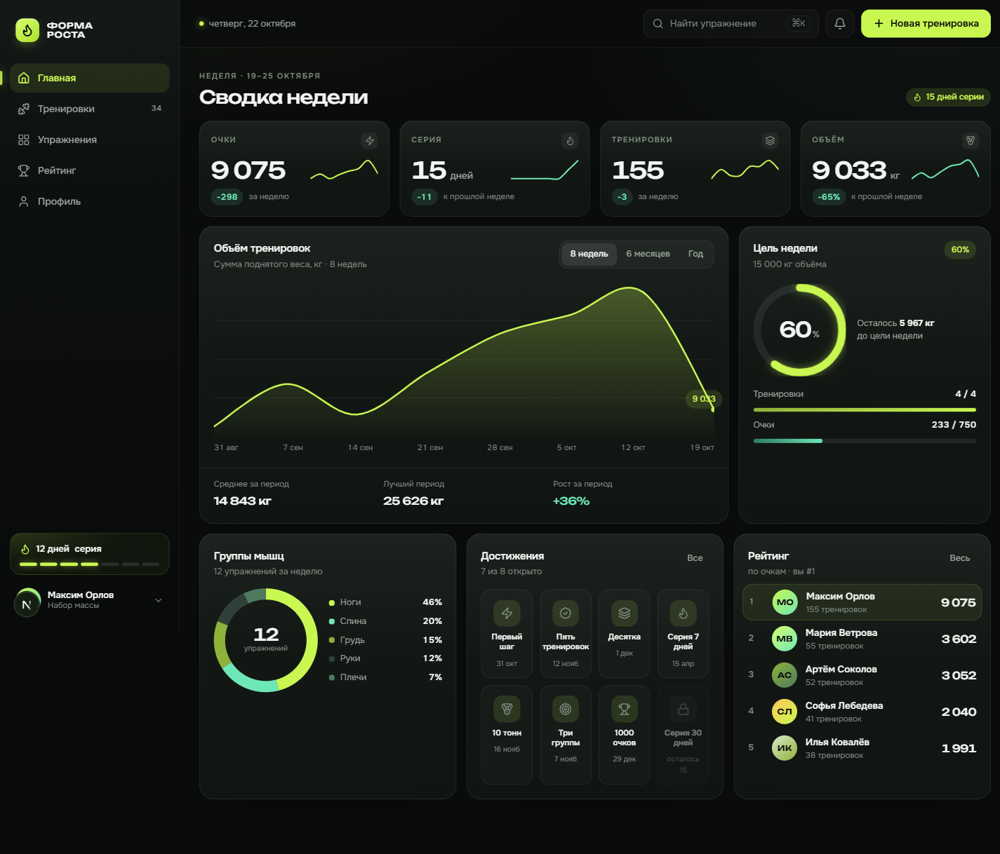
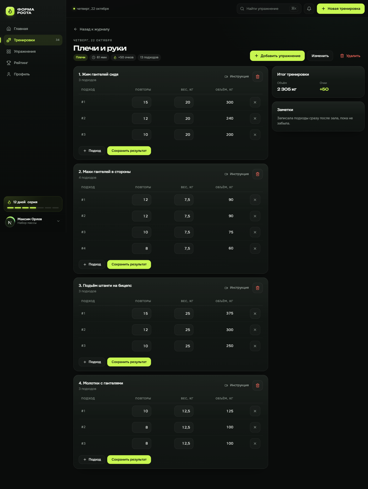
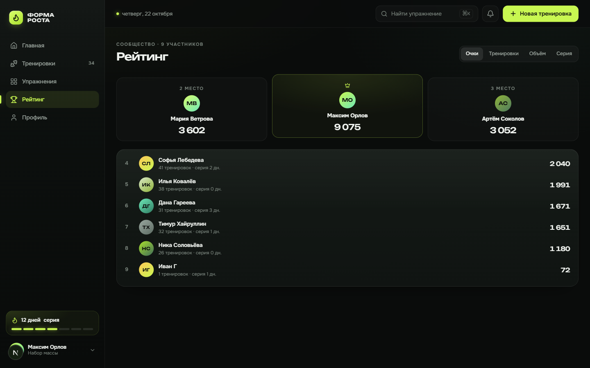

# Форма роста

Фитнес-трекер с геймификацией: тренировки и результаты, поиск упражнений,
прогресс, очки, достижения и рейтинг сообщества. Конкурсное задание
«Профессионалы 2026», компетенция «Веб-технологии».

Репозиторий: <https://github.com/belikebigjohn/belike-SkillFit_tracker>

## Быстрый старт

```
npm install
npm run dev
```

Открыть <http://localhost:3000> (редирект на `/login`). При первом запросе
приложение само создаёт базу `data/app.db`, поднимает схему и наполняет её
демо-данными — отдельных миграций и seed-скриптов запускать не нужно.
`npm run db:reset` удаляет `data/` — после следующего запуска база
пересоздаётся и засевается заново.

## Демо-доступ

| E-mail | Пароль | Кто это |
|---|---|---|
| `demo@forma.ru` | `demo1234` | **Максим Орлов** — основной аккаунт для показа: 155 тренировок за 52 недели, серия 15 дней, 9 075 очков, 1-е место в рейтинге, 7 из 8 достижений |
| `maria@forma.ru`, `artem@forma.ru`, `dana@forma.ru`, `ilya@forma.ru`, `sofya@forma.ru`, `timur@forma.ru`, `nika@forma.ru` | `demo1234` | семь участников рейтинга с историей за 16 недель |

Можно зарегистрировать новый аккаунт — все экраны у него пустые, с подсказкой
и действием (записать первую тренировку). Очки и достижения начисляются сразу.

## Экраны

- `/dashboard` — сводка недели (KPI с дельтами к прошлой неделе), график объёма
  с переключателем периода, кольцо цели, донат групп мышц, достижения, топ рейтинга
- `/workouts` — журнал тренировок, разбивка по неделям, серия, создание новой
- `/workouts/:id` — редактор тренировки: подходы × вес, добавление/удаление
  упражнений из каталога, сохранение результата, заметки, удаление тренировки
- `/exercises` — каталог 19 упражнений: живой поиск, фильтр по группе мышц,
  инструкция, ссылка на видео, добавление в любую тренировку
- `/leaderboard` — рейтинг: подиум топ-3, свою строку видно всегда, переключение
  метрик (очки / тренировки / объём / серия)
- `/profile` — аккаунт, KPI, личные рекорды, история, достижения, редактирование
- `/login`, `/register` — брендовый сплит-скрин с валидацией

Каждый экран имеет состояния loading (skeleton), empty (с действием) и error
с кнопкой «Повторить». Адаптив от 360 px (bottom-tab-bar) до 1440 px.

## Скриншоты

Дашборд — демо-аккаунт после авто-seed:



Тренировка — редактор подходов и весов:



Рейтинг:



## Стек

- Next.js 15.5 (App Router) + React 19 + TypeScript strict — интерфейс и REST API
  в одном процессе, без CORS и второго терминала
- Drizzle ORM + better-sqlite3: файл `data/app.db`, WAL. Схема поднимается
  `CREATE TABLE IF NOT EXISTS` при старте, авто-seed при пустой таблице users
- Аутентификация: bcryptjs + JWT (`jose`, HS256) в httpOnly-cookie `sid`, 30 дней.
  Без NextAuth и внешних сервисов
- Tailwind CSS v4 + рукописные UI-компоненты на дизайн-токенах (CSS-переменные),
  lucide-react
- Zod — валидация на границе API и форм; Sonner — тосты
- Шрифты Unbounded / Onest через `@fontsource-variable` (кириллица, работают офлайн)
- Графики — рукописный SVG, анимации — CSS (transform/opacity, `prefers-reduced-motion`)

## REST API

Все ответы — JSON, клиент ходит только через `src/lib/api-client.ts`.
Ошибки: `{ "error": { "code", "message", "fields?" } }`, коды 400/401/403/404/409/500.

| Метод | Путь | Что делает |
|---|---|---|
| POST | `/api/auth/register` | регистрация (201), ставит cookie |
| POST | `/api/auth/login` | вход; 401 при неверных данных |
| POST | `/api/auth/logout` | выход, чистит cookie |
| GET / PATCH | `/api/me` | профиль / имя и цель |
| GET | `/api/exercises?q=&muscle=` | поиск упражнений |
| GET / POST | `/api/workouts` | список / создание черновика |
| GET / PATCH / DELETE | `/api/workouts/:id` | карточка / параметры / удаление |
| POST | `/api/workouts/:id/exercises` | добавить упражнение `{ exerciseId }` |
| PATCH | `/api/workouts/:id/exercises` | сохранить результат `{ itemId, sets, ... }` |
| DELETE | `/api/workouts/:id/exercises` | убрать упражнение `{ itemId }` |
| GET | `/api/stats?period=week\|month\|all` | агрегаты дашборда (сервер считает всё: дельты, графики, кольца) |
| GET | `/api/leaderboard?metric=points\|workouts\|volume\|streak` | рейтинг с местом текущего пользователя |
| GET | `/api/achievements` | достижения пользователя с прогрессом |
| GET | `/api/records` | личные рекорды по упражнениям |

Чужие тренировки доступны только владельцу: не-владельцу — 404.
Мутации возвращают обновлённые view-модели целиком, плюс `unlocked` — список
свежеоткрытых достижений (фронт показывает тосты).

## Модель данных

`users`, `exercises` (19), `workouts` (group, minutes, volume_kg — денормализованы
для быстрых агрегатов), `workout_exercises` (подходы одним JSON-полем `sets_json`:
`[{ reps, weightKg }]`), `achievements` (8), `user_achievements`, `point_events`.

Формулы геймификации — только в `src/lib/scoring.ts` (чистые функции, их же
использует seed):

- силовая тренировка: `10 + floor(объём_кг / 100)`
- кардио: `max(10, минуты)`
- бонус серии: `×(1 + 0.1 × min(streak, 5))`
- достижения: первый шаг, 5 и 10 тренировок, серии 7 и 30 дней, 10 тонн за неделю,
  три группы мышц, 1000 очков

## Команды

```
npm run dev        — разработка (автоматический seed при первом запросе)
npm run build      — продакшен-сборка
npm start          — запуск собранного приложения
npm run typecheck  — tsc --noEmit
npm run lint       — eslint
npm run db:reset   — удалить data/ (база пересоздастся и засеется на следующем запросе)
```

## Конфигурация

`.env` (не в git), см. `.env.example`:

- `SESSION_SECRET` — подпись JWT. Без него приложение работает на dev-секрете;
  для деплоя задайте свой: `node -e "console.log(crypto.randomBytes(32).toString('hex'))"`

## Структура

```
src/app/(auth)/login, register        экраны входа
src/app/(app)/…                       приложение: guard в layout, страницы — клиентские
src/app/api/…                         REST route handlers
src/components/app|ui                 доменные компоненты и базовые контролы
src/db/seed.ts                        детерминированный seed: 8 аккаунтов, год истории
src/lib/db.ts                         SQLite + DDL + авто-seed
src/lib/schema.ts                     таблицы Drizzle
src/lib/queries.ts / mutations.ts     read-side / write-side агрегаты
src/lib/auth.ts                       bcrypt + JWT cookie
src/lib/scoring.ts                    очки и достижения
src/lib/api-client.ts                 единственный клиент данных для фронта
src/lib/validators.ts / http.ts       zod-схемы, формат ответов
```

## Статус

Модули A и B завершены: интерфейс полностью на реальном API, база SQLite
с демо-данными, сборка и проверки зелёные.
